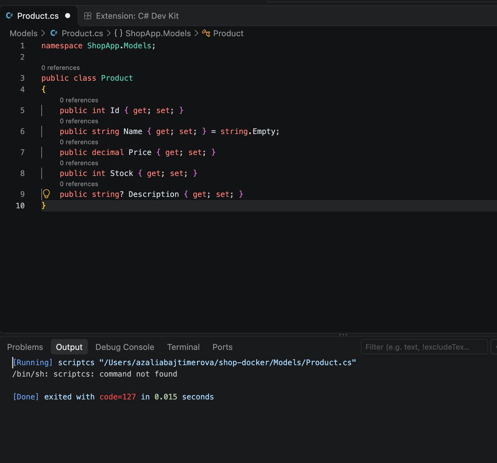
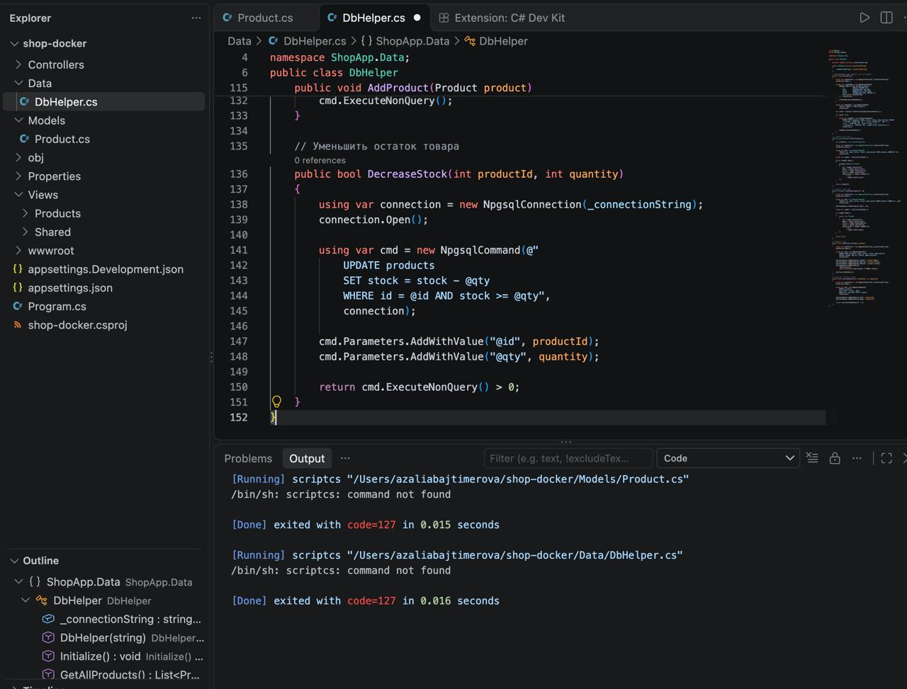
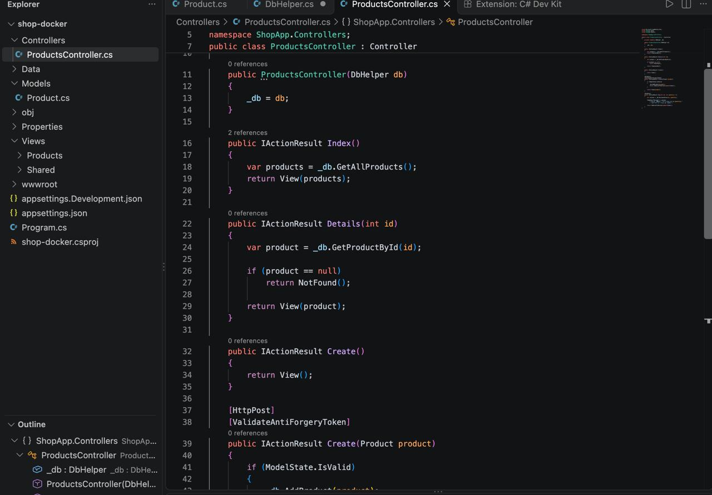
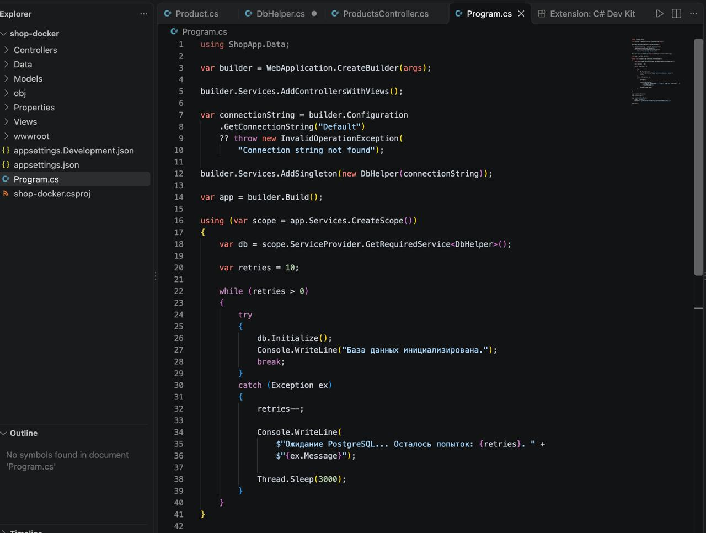
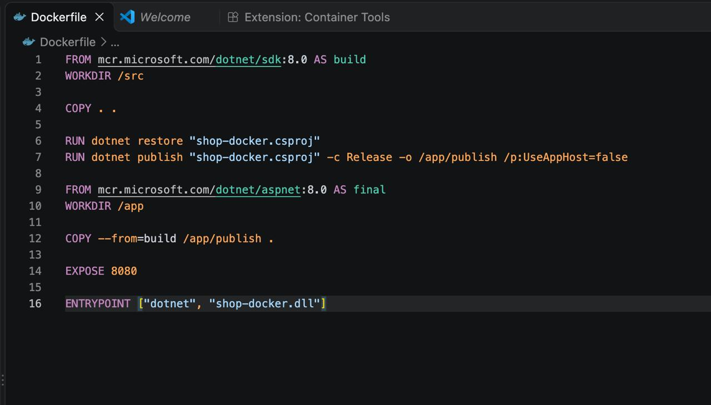
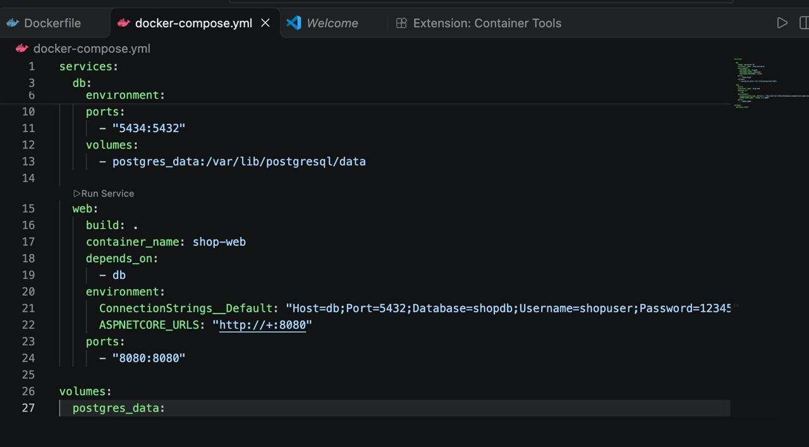
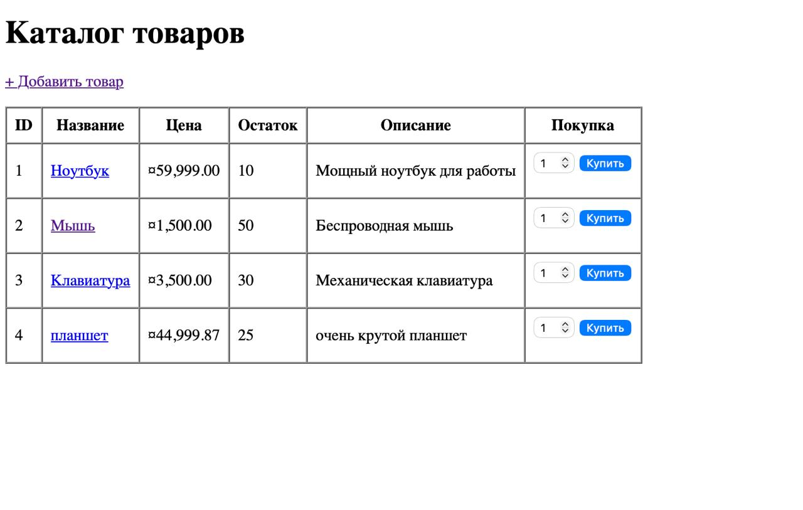
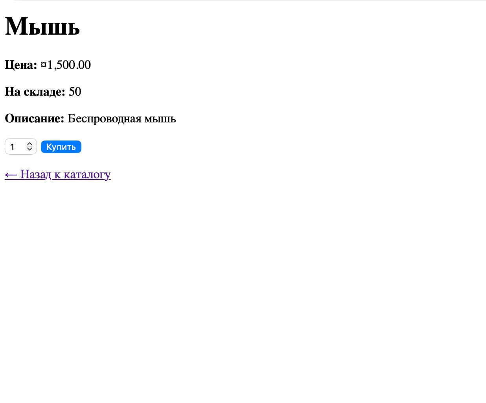
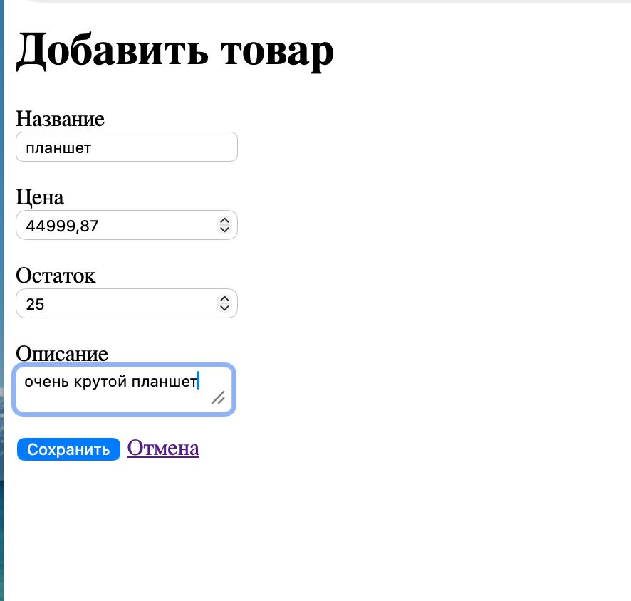

# Домашняя работа за 22.10.26
## 1. Цель работы

В рамках практической работы необходимо создать простое веб-приложение интернет-магазина.

Приложение должно:

- отображать список товаров;
- показывать информацию о конкретном товаре;
- позволять добавлять товары;
- хранить данные в PostgreSQL;
- работать с базой данных через ADO.NET;
- запускаться в Docker;
- состоять из веб-приложения и отдельного контейнера с базой данных.

---

# 2. Подготовка среды разработки

Проект выполнялся на macOS.

Для работы были установлены:

- Visual Studio Code;
- .NET SDK 10.0.402;
- расширения C# и .NET Install Tool для Visual Studio Code;
- Docker;

---

# 3. Создание проекта

Для создания проекта использовался ASP.NET Core MVC.

Структура проекта создавалась с помощью .NET CLI и затем открывалась в Visual Studio Code.

Основные папки проекта:

```text
shop-docker/
├── Controllers/
├── Data/
├── Models/
├── Views/
├── Properties/
├── wwwroot/
├── Program.cs
├── appsettings.json
├── Dockerfile
├── docker-compose.yml
└── shop-docker.csproj
```

### Назначение папок

**Models** — модели данных.

**Views** — HTML-страницы приложения.

**Controllers** — обработка запросов пользователя.

**Data** — работа с базой данных.

**wwwroot** — статические файлы: CSS, JavaScript, изображения.

**Program.cs** — запуск и настройка приложения.

---

# 4. Создание модели Product

 
Первым делом была создана модель товара:

```text
Models/Product.cs
```

Код:

```csharp
namespace ShopApp.Models;

public class Product
{
    public int Id { get; set; }

    public string Name { get; set; } = string.Empty;

    public decimal Price { get; set; }

    public int Stock { get; set; }

    public string? Description { get; set; }
}
```

## Что делает этот код

Класс `Product` описывает один товар.

### Свойства:

```csharp
public int Id { get; set; }
```

Уникальный идентификатор товара.

```csharp
public string Name { get; set; }
```

Название товара.

```csharp
public decimal Price { get; set; }
```

Цена товара.

Для цены используется `decimal`, поскольку этот тип подходит для денежных значений.

```csharp
public int Stock { get; set; }
```

Количество товара на складе.

```csharp
public string? Description { get; set; }
```

Описание товара. Знак `?` означает, что описание может отсутствовать.

---

# 5. Подключение PostgreSQL

Для хранения товаров используется PostgreSQL.

В Docker Compose создаётся отдельный контейнер базы данных.

Название базы:

```text
shopdb
```

Пользователь:

```text
shopuser
```

Пароль:

```text
12345
```

Для подключения приложения к PostgreSQL используется библиотека **Npgsql**, которая предоставляет ADO.NET-провайдер для PostgreSQL.

---

# 6. Работа с базой данных через ADO.NET
 
Для работы с базой был создан файл:

```text
Data/DbHelper.cs
```

Главная задача `DbHelper` — выполнять SQL-запросы к PostgreSQL.

Подключение осуществляется через `NpgsqlConnection`.

Общий принцип работы:

```text
C# приложение
      ↓
NpgsqlConnection
      ↓
PostgreSQL
      ↓
таблица products
```

## Создание подключения

Используется строка подключения:

```csharp
var connection = new NpgsqlConnection(connectionString);
```

После этого подключение открывается:

```csharp
connection.Open();
```

После выполнения операции подключение закрывается.

---

# 7. Создание таблицы products

При запуске приложения база должна подготовиться автоматически.

В базе создаётся таблица:

```sql
CREATE TABLE IF NOT EXISTS products
(
    id SERIAL PRIMARY KEY,
    name VARCHAR(200) NOT NULL,
    price NUMERIC(18,2) NOT NULL,
    stock INTEGER NOT NULL,
    description VARCHAR(500)
);
```

## Назначение столбцов

| Столбец | Назначение |
|---|---|
| `id` | идентификатор товара |
| `name` | название |
| `price` | цена |
| `stock` | количество на складе |
| `description` | описание |

`PRIMARY KEY` делает поле `id` уникальным идентификатором записи.

`NOT NULL` запрещает оставлять обязательные поля пустыми.

---

# 8. Добавление начальных товаров

После создания таблицы проверяется, есть ли в ней товары.

Если таблица пустая, добавляются начальные записи.

Например:

```sql
INSERT INTO products
    (name, price, stock, description)
VALUES
    ('Ноутбук', 79999.99, 10, 'Игровой ноутбук'),
    ('Мышь', 2999.99, 25, 'Беспроводная мышь'),
    ('Клавиатура', 4999.99, 15, 'Механическая клавиатура');
```

Это позволяет после первого запуска сразу увидеть товары в каталоге.

---

# 9. Получение списка товаров

Для отображения каталога выполняется SQL-запрос:

```sql
SELECT id, name, price, stock, description
FROM products
ORDER BY id;
```

В C# используется объект `NpgsqlCommand`.

Пример:

```csharp
using var command = new NpgsqlCommand(sql, connection);
using var reader = command.ExecuteReader();
```

`ExecuteReader()` выполняет SELECT-запрос и возвращает результаты.

Затем данные считываются построчно:

```csharp
while (reader.Read())
{
    // получение данных товара
}
```

После этого данные преобразуются в объекты `Product`.

---

# 10. Получение одного товара

Для страницы с подробной информацией используется запрос:

```sql
SELECT id, name, price, stock, description
FROM products
WHERE id = @id;
```

Здесь используется параметр:

```text
@id
```

Значение передаётся отдельно от SQL-кода.

Например:

```csharp
command.Parameters.AddWithValue("@id", id);
```

Использование параметров является важной частью работы с базой данных, поскольку пользовательские значения не вставляются напрямую в SQL-строку.

---

# 11. Добавление товара

Для добавления нового товара используется SQL:

```sql
INSERT INTO products
    (name, price, stock, description)
VALUES
    (@name, @price, @stock, @description);
```

Параметры передаются отдельно:

```csharp
command.Parameters.AddWithValue("@name", product.Name);
command.Parameters.AddWithValue("@price", product.Price);
command.Parameters.AddWithValue("@stock", product.Stock);
command.Parameters.AddWithValue("@description",
    (object?)product.Description ?? DBNull.Value);
```

После этого выполняется:

```csharp
command.ExecuteNonQuery();
```

`ExecuteNonQuery()` используется для SQL-команд, которые изменяют данные и не возвращают таблицу результатов.

---

# 12. Уменьшение количества товара

При покупке товара необходимо уменьшить его количество на складе.

Для этого используется SQL-запрос:

```sql
UPDATE products
SET stock = stock - 1
WHERE id = @id
  AND stock > 0;
```

Условие:

```sql
AND stock > 0
```

не позволяет уменьшить остаток товара ниже нуля.

---

# 13. Создание контроллера
 
Для управления товарами создан:

```text
Controllers/ProductsController.cs
```

Контроллер связывает модель, базу данных и представления.

Основные действия:

```text
Index
Details
Create
Buy
```

---

# 14. Метод Index

Метод `Index` получает все товары:

```csharp
public IActionResult Index()
{
    var products = DbHelper.GetAllProducts();

    return View(products);
}
```

Здесь происходит следующее:

1. вызывается `GetAllProducts()`;
2. из базы получается список товаров;
3. список передаётся в представление;
4. пользователю отображается каталог.

---

# 15. Метод Details

Метод `Details` показывает один товар.

Принцип работы:

```csharp
public IActionResult Details(int id)
{
    var product = DbHelper.GetProductById(id);

    if (product == null)
        return NotFound();

    return View(product);
}
```

Если товар не найден, возвращается:

```csharp
NotFound();
```

Если товар существует, он передаётся в `Details.cshtml`.

---

# 16. Добавление товара через Controller

Для формы добавления используется два метода `Create`.

GET-метод открывает форму:

```csharp
[HttpGet]
public IActionResult Create()
{
    return View();
}
```

POST-метод получает данные формы:

```csharp
[HttpPost]
[ValidateAntiForgeryToken]
public IActionResult Create(Product product)
{
    if (!ModelState.IsValid)
        return View(product);

    DbHelper.AddProduct(product);

    return RedirectToAction(nameof(Index));
}
```

GET отвечает за отображение формы.

POST отвечает за получение и сохранение данных.

---

# 17. Представление Index.cshtml

Файл:

```text
Views/Products/Index.cshtml
```

используется для отображения каталога.

Представление получает список товаров:

```cshtml
@model IEnumerable<ShopApp.Models.Product>
```

После этого можно перебрать товары:

```cshtml
@foreach (var product in Model)
{
    <div>
        <h2>@product.Name</h2>
        <p>@product.Price</p>
        <p>Остаток: @product.Stock</p>
    </div>
}
```

Razor позволяет использовать C# непосредственно внутри HTML.

---

# 18. Представление Details.cshtml

Файл:

```text
Views/Products/Details.cshtml
```

отображает подробную информацию об одном товаре.

Модель:

```cshtml
@model ShopApp.Models.Product
```

Вывод данных:

```cshtml
<h1>@Model.Name</h1>

<p>Цена: @Model.Price</p>

<p>На складе: @Model.Stock</p>

<p>@Model.Description</p>
```

`Model` содержит объект товара, переданный контроллером.

---

# 19. Представление Create.cshtml

Файл:

```text
Views/Products/Create.cshtml
```

содержит форму добавления товара.

Например:

```cshtml
<form asp-action="Create" method="post">

    @Html.AntiForgeryToken()

    <input asp-for="Name" />
    <input asp-for="Price" />
    <input asp-for="Stock" />
    <textarea asp-for="Description"></textarea>

    <button type="submit">
        Сохранить
    </button>

</form>
```

Атрибуты `asp-for` связывают HTML-поля со свойствами модели `Product`.

Например:

```cshtml
<input asp-for="Name" />
```

связывает поле формы со свойством:

```csharp
Product.Name
```

---

# 20. Файл _ViewImports.cshtml

Для работы Razor Tag Helpers был создан:

```text
Views/_ViewImports.cshtml
```

Содержимое:

```cshtml
@using ShopApp.Models
@addTagHelper *, Microsoft.AspNetCore.Mvc.TagHelpers
```

`@using` позволяет использовать классы из пространства имён моделей.

`@addTagHelper` подключает Tag Helpers, благодаря которым работают конструкции:

```cshtml
asp-action
asp-for
```

и другие вспомогательные атрибуты ASP.NET Core.

---

# 21. Настройка Program.cs
 
Файл:

```text
Program.cs
```

является точкой входа приложения.

В нём создаётся и настраивается веб-приложение:

```csharp
var builder = WebApplication.CreateBuilder(args);

builder.Services.AddControllersWithViews();

var app = builder.Build();
```

Затем настраивается обработка HTTP-запросов:

```csharp
app.UseStaticFiles();

app.UseRouting();
```

После этого задаётся маршрут MVC:

```csharp
app.MapControllerRoute(
    name: "default",
    pattern: "{controller=Products}/{action=Index}/{id?}");
```

Поэтому при открытии сайта пользователь сразу попадает на:

```text
ProductsController
        ↓
Index()
        ↓
Views/Products/Index.cshtml
```

---

# 22. Настройка Dockerfile

 
Для контейнеризации приложения создан файл:

```text
Dockerfile
```

Используется многоэтапная сборка.

Первый этап:

```dockerfile
FROM mcr.microsoft.com/dotnet/sdk:8.0 AS build
```

Используется полный .NET SDK.

Далее копируются файлы проекта:

```dockerfile
WORKDIR /src
COPY . .
```

Восстанавливаются зависимости:

```dockerfile
RUN dotnet restore "shop-docker.csproj"
```

Проект публикуется:

```dockerfile
RUN dotnet publish "shop-docker.csproj" \
    -c Release \
    -o /app/publish \
    /p:UseAppHost=false
```

После этого используется отдельный runtime-образ:

```dockerfile
FROM mcr.microsoft.com/dotnet/aspnet:8.0 AS final
```

Опубликованные файлы копируются:

```dockerfile
COPY --from=build /app/publish .
```

Указывается порт:

```dockerfile
EXPOSE 8080
```

И команда запуска:

```dockerfile
ENTRYPOINT ["dotnet", "shop-docker.dll"]
```

---

# 23. Docker Compose

 
Для одновременного запуска приложения и PostgreSQL используется:

```text
docker-compose.yml
```

В нём описаны два сервиса:

```yaml
services:
  db:
    ...
    
  web:
    ...
```

## Контейнер базы данных

```yaml
db:
  image: postgres:16
```

Используется PostgreSQL 16.

Настройки базы:

```yaml
POSTGRES_DB: shopdb
POSTGRES_USER: shopuser
POSTGRES_PASSWORD: 12345
```

Порт:

```yaml
ports:
  - "5434:5432"
```

Внутри Docker PostgreSQL работает на `5432`, а с компьютера к нему можно обратиться через `5434`.

Для сохранения данных используется volume:

```yaml
volumes:
  - postgres_data:/var/lib/postgresql/data
```

---

# 24. Контейнер веб-приложения

Второй сервис:

```yaml
web:
  build: .
```

означает, что Docker должен собрать приложение по `Dockerfile`.

Контейнер получает имя:

```yaml
container_name: shop-web
```

Веб-приложение зависит от базы:

```yaml
depends_on:
  - db
```

Подключение к PostgreSQL:

```yaml
ConnectionStrings__Default: "Host=db;Port=5432;Database=shopdb;Username=shopuser;Password=12345"
```

Здесь особенно важно значение:

```text
Host=db
```

`db` — это имя сервиса PostgreSQL внутри Docker Compose.

Приложение слушает порт:

```yaml
ASPNETCORE_URLS: "http://+:8080"
```

Порт контейнера публикуется наружу:

```yaml
ports:
  - "8080:8080"
```

Поэтому приложение открывается в браузере по адресу:

```text
http://localhost:8080
```

---

# 25. Схема работы Docker

После запуска получается следующая схема:

```text
                    Mac
                     │
                     │ http://localhost:8080
                     ↓
              ┌──────────────┐
              │   shop-web   │
              │ ASP.NET Core │
              │     :8080   │
              └───────┬──────┘
                      │
                      │ db:5432
                      ↓
              ┌──────────────┐
              │shop-postgres │
              │ PostgreSQL16 │
              │     :5432    │
              └──────────────┘
                      │
                      ↓
                postgres_data
```

---

# 26. Сборка проекта

Перед запуском была выполнена проверка проекта:

```bash
dotnet build
```

Эта команда компилирует проект и проверяет наличие ошибок.

При успешной сборке появляется сообщение:

```text
Build succeeded.
```

Это означает, что исходный код проекта успешно скомпилирован.

---

# 27. Запуск Docker

Для сборки и запуска всех контейнеров используется:

```bash
docker compose up --build
```

Параметр:

```text
--build
```

заставляет Docker заново собрать образ веб-приложения.

После запуска должны работать:

```text
shop-web
shop-postgres
```

Проверить контейнеры можно:

```bash
docker ps
```

---

# 28. Проверка приложения

После запуска Docker приложение открывается в браузере:

```text
http://localhost:8080
```

Проверяются следующие функции:

### Каталог

 
Открывается список товаров из PostgreSQL.

### Страница товара

 
При выборе товара открывается подробная информация.

### Добавление товара

 
Открывается форма:

```text
Название
Цена
Остаток
Описание
```

После отправки формы данные записываются в PostgreSQL.

### Покупка

При покупке товара количество `stock` уменьшается на единицу.

---

# 29. Git и GitHub

После завершения проекта он был помещён в существующий репозиторий GitHub `ADO.NET`.

Структура репозитория:

```text
ADO.NET
└── Домашняя работа
    └── ДЗ_1
        └── Готовый проект
            └── shop-docker
```

Для добавления проекта в Git использовались команды:

```bash
git add "Домашняя работа/ДЗ_1/Готовый проект/shop-docker"
```

Проверка:

```bash
git status
```

Создание коммита:

```bash
git commit -m "Добавлен готовый проект интернет-магазина"
```

Отправка проекта на GitHub:

```bash
git push
```

В результате проект хранится в существующем GitHub-репозитории вместе с остальными учебными материалами.

---

# 30. Итоговый процесс создания проекта

Вся работа выполнялась в следующем порядке:

```text
1. Установка .NET и VS Code
             ↓
2. Создание ASP.NET Core MVC проекта
             ↓
3. Создание модели Product
             ↓
4. Подключение PostgreSQL
             ↓
5. Создание DbHelper
             ↓
6. Создание таблицы products
             ↓
7. Реализация SQL-запросов через ADO.NET
             ↓
8. Создание ProductsController
             ↓
9. Создание Razor Views
             ↓
10. Настройка Program.cs
             ↓
11. Создание Dockerfile
             ↓
12. Создание docker-compose.yml
             ↓
13. Сборка проекта через dotnet build
             ↓
14. Запуск через docker compose
             ↓
15. Проверка сайта
             ↓
16. Загрузка проекта в GitHub
```

## Результат

В результате создано контейнеризированное веб-приложение интернет-магазина.

Приложение использует:

- **C#** для программирования;
- **ASP.NET Core MVC** для веб-приложения;
- **Razor** для представлений;
- **ADO.NET / Npgsql** для работы с PostgreSQL;
- **PostgreSQL** для хранения товаров;
- **Docker** для контейнеризации;
- **Docker Compose** для запуска приложения и базы данных;
- **Git/GitHub** для хранения исходного кода проекта.


