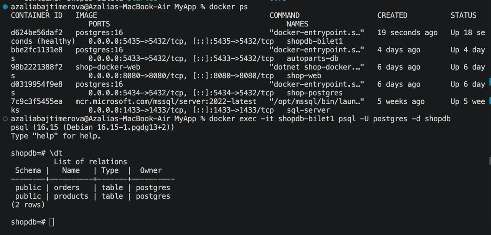

# Билет № 1. Интернет-магазин: каталог товаров

## Описание задания

Разработка небольшого backend-приложения интернет-магазина на ASP.NET Core Minimal API с использованием PostgreSQL.

Приложение позволяет получать список товаров, формировать отчёт по товарам и оформлять заказы. Для взаимодействия с базой данных используются ADO.NET, Dapper и Npgsql.

## Используемые технологии

- C# / .NET 8
- ASP.NET Core Minimal API
- PostgreSQL 16
- Docker и Docker Compose
- Npgsql
- ADO.NET
- Dapper

## Структура базы данных

База данных: `shopdb`.

Созданы две таблицы.

 
### Таблица products

| Поле | Тип | Описание |
|---|---|---|
| id | SERIAL PRIMARY KEY | Идентификатор товара |
| name | VARCHAR(100) | Название товара |
| price | NUMERIC(10,2) | Цена товара |

Добавлены тестовые товары:

| ID | Название | Цена |
|---:|---|---:|
| 1 | Ноутбук | 75000.00 |
| 2 | Мышь | 1500.00 |
| 3 | Клавиатура | 3500.00 |

### Таблица orders

| Поле | Тип | Описание |
|---|---|---|
| id | SERIAL PRIMARY KEY | Идентификатор заказа |
| product_id | INT | Ссылка на товар |
| qty | INT | Количество |
| created_at | TIMESTAMP | Дата создания заказа |

## Реализованные API-эндпоинты

### 1. GET /products?min=

Получение списка товаров с фильтрацией по минимальной цене.

Используемые механизмы:
- NpgsqlConnection — подключение к PostgreSQL;
- NpgsqlCommand — выполнение SQL-запроса;
- SQL-параметры — передача минимальной цены;
- ExecuteReaderAsync — чтение результатов;
- async/await — асинхронное выполнение операций.

### 2. GET /products/dapper?min=

Получение списка товаров с помощью Dapper.

Dapper упрощает выполнение SQL-запросов и преобразование результатов в объекты C#.

### 3. GET /products/dataset

Формирование отчёта по товарам с использованием:
- DataSet;
- DataAdapter;
- DataTable;
- DataTable.Select для фильтрации строк.

DataAdapter заполняет DataSet данными из базы данных, после чего приложение работает с таблицей в памяти.

### 4. POST /orders

Оформление заказа с использованием транзакции.

Последовательность действий:
1. Получение данных о товаре и количестве.
2. Проверка существования товара.
3. Начало транзакции.
4. Добавление заказа в таблицу orders.
5. Подтверждение транзакции через Commit.
6. При ошибке — отмена транзакции через Rollback.

## Дополнительные механизмы

- **Параметризованные запросы** — передача значений отдельно от SQL-кода.
- **Асинхронность** — использование async/await и асинхронных методов Npgsql.
- **Пул соединений** — включён через параметр Pooling в строке подключения.
- **Транзакции** — обеспечение согласованного выполнения операций с заказами.

## Запуск проекта

### 1. Запуск PostgreSQL

Перейти в папку MyApp:

```bash
cd MyApp
```

Запустить контейнер базы данных:

```bash
docker compose up -d
```

Проверить состояние контейнера:

```bash
docker ps
```

### 2. Запуск ASP.NET Core

В папке MyApp выполнить:

```bash
dotnet restore
dotnet build
dotnet run
```

Приложение запускается локально. В текущей конфигурации адрес:

```text
http://localhost:5232
```

### 3. Проверка API

Получение всех товаров:

```text
http://localhost:5232/products?min=0
```

Получение товаров через Dapper:

```text
http://localhost:5232/products/dapper?min=0
```

Получение отчёта через DataSet:

```text
http://localhost:5232/products/dataset
```

Оформление заказа можно проверить командой:

```bash
curl -X POST http://localhost:5232/orders \
-H "Content-Type: application/json" \
-d '{"productId":1,"qty":2}'
```

## Проверка работы

В ходе выполнения задания проверены:
- получение списка товаров через ADO.NET;
- получение списка товаров через Dapper;
- формирование отчёта через DataSet;
- успешное оформление заказа;
- сохранение заказа в PostgreSQL;
- обработка ситуации, когда товар с указанным ID не существует.

## Скриншоты

Скриншоты работы приложения, базы данных и Docker находятся в папке `screenshots`.

1. Запуск Docker-контейнера.
2. Создание таблиц базы данных.
3. Просмотр тестовых товаров в PostgreSQL.
4. Получение товаров через ADO.NET.
5. Получение товаров через Dapper.
6. Получение отчёта через DataSet.
7. Успешное оформление заказа.
8. Проверка записи в таблице orders.
9. Обработка отсутствующего товара.
10. Проверка отсутствия ошибочного заказа в базе.
11. Проверка количества заказов.

---

**Результат:** реализовано ASP.NET Core Minimal API приложение интернет-магазина с PostgreSQL, ADO.NET, Dapper, DataSet и транзакционной обработкой заказов.
