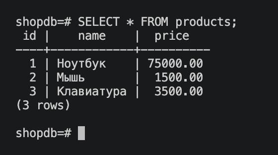
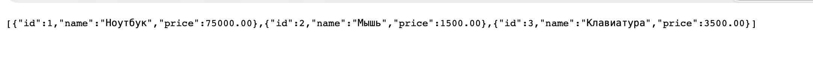
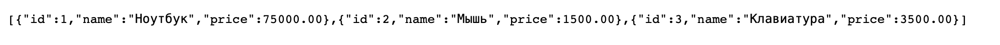
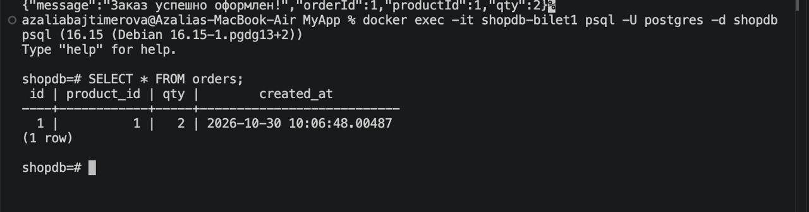
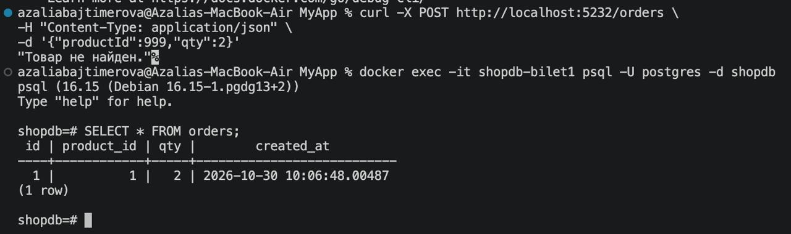

# Билет № 1. Интернет-магазин: каталог товаров

## Описание задания

Разработка небольшого backend-приложения интернет-магазина на ASP.NET Core Minimal API с использованием PostgreSQL.

Приложение позволяет получать список товаров, формировать отчёт по товарам и оформлять заказы. Для взаимодействия с базой данных используются ADO.NET, Dapper и Npgsql.

## Используемые технологии

- C# / .NET 8
- ASP.NET Core Minimal API
- PostgreSQL 16
- Docker и Docker Compose
- Npgsql
- ADO.NET
- Dapper

## Структура базы данных

База данных: `shopdb`.

Созданы две таблицы.

 
### Таблица products

| Поле | Тип | Описание |
|---|---|---|
| id | SERIAL PRIMARY KEY | Идентификатор товара |
| name | VARCHAR(100) | Название товара |
| price | NUMERIC(10,2) | Цена товара |

Добавлены тестовые товары:

 
### Таблица orders

| Поле | Тип | Описание |
|---|---|---|
| id | SERIAL PRIMARY KEY | Идентификатор заказа |
| product_id | INT | Ссылка на товар |
| qty | INT | Количество |
| created_at | TIMESTAMP | Дата создания заказа |

## Реализованные API-эндпоинты

### 1. GET /products?min=

Получение списка товаров с фильтрацией по минимальной цене.

 


### 2. GET /products/dapper?min=

Получение списка товаров с помощью Dapper.

 

Dapper упрощает выполнение SQL-запросов и преобразование результатов в объекты C#.

### 3. GET /products/dataset

   

DataAdapter заполняет DataSet данными из базы данных, после чего приложение работает с таблицей в памяти.

### 4. Успешное оформление заказа:

   

### 5. обработка ситуации, когда товар с указанным ID не существует:


   

## Запуск проекта

### 1. Запуск PostgreSQL

Перейти в папку MyApp:

```bash
cd MyApp
```

Запустить контейнер базы данных:

```bash
docker compose up -d
```

Проверить состояние контейнера:

```bash
docker ps
```

### 2. Запуск ASP.NET Core

В папке MyApp выполнить:

```bash
dotnet restore
dotnet build
dotnet run
```

Приложение запускается локально. В текущей конфигурации адрес:

```text
http://localhost:5232
```

### 3. Проверка API

Получение всех товаров:

```text
http://localhost:5232/products?min=0
```

Получение товаров через Dapper:

```text
http://localhost:5232/products/dapper?min=0
```

Получение отчёта через DataSet:

```text
http://localhost:5232/products/dataset
```

Оформление заказа можно проверить командой:

```bash
curl -X POST http://localhost:5232/orders \
-H "Content-Type: application/json" \
-d '{"productId":1,"qty":2}'
```

## Проверка работы

В ходе выполнения задания проверены:
- получение списка товаров через ADO.NET;
- получение списка товаров через Dapper;
- формирование отчёта через DataSet;
- успешное оформление заказа;
- сохранение заказа в PostgreSQL;
- обработка ситуации, когда товар с указанным ID не существует.
